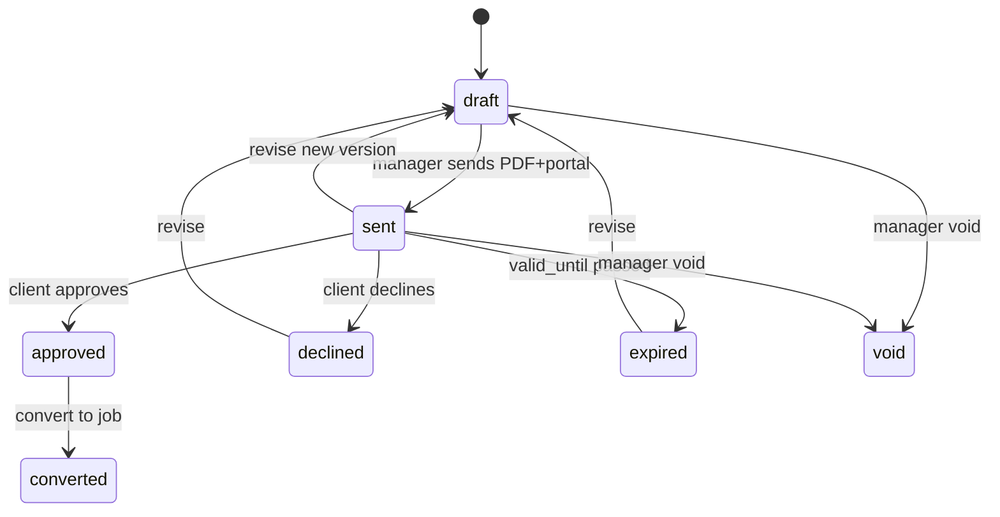

# Quotes, proposals & invoicing — design plan

**Status:** Implemented on branch `lurk/quotes-invoices-plan-2da6` (PR #60). Migrations `0025_search_notify`, `0026_commercial_core`, `0027_commercial_client_rls` (after PR #61’s `0025`).
**Priority:** P2 in [QA_REPORT_2026-10-28.md](./QA_REPORT_2026-10-28.md) — parity with **Current RMS**, **Rentman**, **Goodshuffle Pro** quote-to-cash.  
**Depends on:** Stable `main` after in-flight work (roles refactor, Resend event email, crew self-removal, search, reports). Do not land migrations until that branch merges.

**Goals**

1. Managers build **branded quotes** from rate cards (equipment SKUs, labor, fleet), send to clients, and get **online approve/decline** in the portal (typed name + timestamp; no third-party e-sign in v1).
2. **Approved quotes convert to jobs** with a durable link; ops run the job as today.
3. **Invoices** post against jobs (planned lines from quote + ad hoc **damage/loss** and adjustments), tenant-branded PDFs, optional **Stripe Payment Link** when keys exist.
4. **Accounting export** (CSV first; QuickBooks Online / Xero API later) without blocking v1 invoicing.

**Non-goals (this initiative)**

- Serialized assets / barcode scan-out (separate P2 item).
- Multi-warehouse costing ( **A18b** deferred).
- Stripe Connect per tenant (design hook only; platform Payment Links first).
- Hard payment lockout on unpaid invoices (align with **D13** — soft pilot).

---

## 1. Benchmark mapping

| Capability | Incumbent pattern | Logiparty v1 target |
|------------|-------------------|---------------------|
| Quote document | Branded PDF + web link | PDF in R2 + portal review page |
| Versioning | Rev A/B after edits | Immutable **sent** snapshots; new revision bumps version |
| Client approval | E-sign or “Accept quote” | Approve / Decline + **signer name** + `approved_at` |
| Deposit | % or fixed on quote | Deposit line + optional deposit invoice |
| Rate card | SKU / crew / vehicle rates | Org tables keyed to existing catalogs |
| Job from quote | Won opportunity → project | `jobs.quote_id` + copy schedule fields |
| Final invoice | Actuals + damage | Invoice lines: quoted + manual damage/loss |
| Pay online | Stripe / Mollie link | Stripe Payment Link when configured |
| Export | QBO / Xero | CSV v1; OAuth integrations v2 |

---

## 2. Data model

All new tables: `org_id` (RLS), `timestamptz` audit fields, UUID PKs unless noted. Update `docs/SCHEMA.md` when implemented.

### 2.1 Enums (proposed)

```ts
quote_status:
  'draft' | 'sent' | 'approved' | 'declined' | 'expired' | 'void'

invoice_status:
  'draft' | 'sent' | 'partially_paid' | 'paid' | 'void' | 'overdue'

quote_line_kind:
  'equipment' | 'labor' | 'fleet' | 'fee' | 'discount' | 'tax' | 'deposit' | 'custom'

invoice_line_kind:
  'equipment' | 'labor' | 'fleet' | 'fee' | 'discount' | 'tax' | 'deposit'
  | 'damage_loss' | 'adjustment' | 'custom'

rate_unit:
  'each' | 'day' | 'hour' | 'flat' | 'percent'
```

### 2.2 Org settings (extend `organizations` or `org_billing_settings`)

| Column | Notes |
|--------|--------|
| quote_prefix | e.g. `Q` |
| invoice_prefix | e.g. `INV` |
| next_quote_number | int, per-org sequence |
| next_invoice_number | int |
| default_tax_rate_bps | basis points (875 = 8.75%) |
| tax_label | e.g. `Sales tax` |
| tax_id | nullable EIN/VAT display on PDF |
| payment_terms_days | default 30 |
| quote_valid_days | default 14 → `valid_until` on send |
| invoice_footer_text | nullable legal/ACH block |

**Numbering:** Monotonic per org via `UPDATE … RETURNING next_*` in the same transaction as insert (no gaps on rollback is acceptable for v1). Display: `{prefix}-{YYYY}-{seq:4}` e.g. `Q-2026-0042`.

### 2.3 Rate cards

**`rate_cards`** — optional named card; one `is_default` per org.

**`rate_card_lines`**

| Column | Notes |
|--------|--------|
| rate_card_id | FK |
| org_id | RLS |
| kind | equipment \| labor \| fleet \| fee |
| inventory_item_id | nullable FK → `inventory_items` |
| fleet_vehicle_id | nullable FK → `fleet_vehicles` |
| labor_role | nullable `assignment_role` or slug `driver`/`laborer`/… |
| description | override label |
| unit | rate_unit |
| unit_price_cents | int |
| min_qty | default 1 |
| is_active | boolean |

Client-specific pricing (optional v1.1): `client_company_id` nullable on line — if set, overrides default for that client.

### 2.4 Quotes

**`quotes`**

| Column | Notes |
|--------|--------|
| org_id | RLS |
| client_company_id | FK |
| quote_number | text UNIQUE(org_id, quote_number) |
| status | quote_status |
| version | int, starts at 1 |
| title | e.g. event name |
| event_start / event_end | timestamptz, for pricing duration |
| valid_until | set on send |
| currency | `USD` v1 |
| subtotal_cents / tax_cents / total_cents | denormalized snapshot |
| deposit_cents | nullable |
| notes_internal | staff only |
| notes_client | on PDF |
| sent_at | nullable |
| sent_by_user_id | nullable |
| job_id | nullable FK → jobs after conversion |
| created_by | FK users |
| created_at / updated_at | |

**`quote_lines`**

| Column | Notes |
|--------|--------|
| quote_id | FK CASCADE |
| org_id | RLS |
| sort_order | int |
| kind | quote_line_kind |
| description | text |
| quantity | numeric(12,4) |
| unit | rate_unit |
| unit_price_cents | int |
| line_total_cents | int |
| taxable | boolean |
| source_rate_card_line_id | nullable audit |
| inventory_item_id / fleet_vehicle_id | nullable refs for equipment/fleet lines |

**`quote_versions`** (immutable snapshots when status leaves `draft` or on “Send new version”)

| Column | Notes |
|--------|--------|
| quote_id | FK |
| org_id | RLS |
| version | int |
| snapshot_json | jsonb — header + lines + totals at send time |
| pdf_storage_key | nullable R2 |
| created_at | |

Only the **latest sent version** is approvable; older sent versions → `superseded` in metadata or quote bump.

**`quote_client_responses`**

| Column | Notes |
|--------|--------|
| quote_id | FK |
| quote_version | int |
| org_id | RLS |
| decision | `approved` \| `declined` |
| signer_name | text — typed “signature” |
| responded_by_user_id | FK → users |
| responded_at | timestamptz |
| decline_reason | nullable text |

One row per version (unique `quote_id, quote_version`).

### 2.5 Invoices

**`invoices`**

| Column | Notes |
|--------|--------|
| org_id | RLS |
| client_company_id | FK |
| job_id | nullable but expected for job billing |
| quote_id | nullable traceability |
| invoice_number | text UNIQUE(org_id, invoice_number) |
| status | invoice_status |
| issue_date | date |
| due_date | date |
| currency | USD |
| subtotal_cents / tax_cents / total_cents | |
| amount_paid_cents | default 0 |
| notes_client / notes_internal | |
| sent_at | nullable |
| paid_at | nullable |
| stripe_payment_link_id | nullable |
| stripe_payment_link_url | nullable |
| pdf_storage_key | nullable R2 |
| created_by | FK |
| created_at / updated_at | |

**`invoice_lines`** — same shape as quote lines + `damage_loss` kind; optional `job_inventory_line_id` for traceability.

**`invoice_payments`** (manual + Stripe webhook)

| Column | Notes |
|--------|--------|
| invoice_id | FK |
| org_id | RLS |
| amount_cents | |
| method | `stripe` \| `check` \| `ach` \| `other` |
| stripe_payment_intent_id | nullable |
| recorded_by_user_id | nullable |
| paid_at | timestamptz |

### 2.6 Job linkage

**`jobs`** (add columns)

| Column | Notes |
|--------|--------|
| quote_id | nullable FK → quotes |
| quote_version | int nullable — which revision was converted |

Conversion copies: `client_company_id`, `name` ← quote title, schedule from quote event window (manager can edit before `upcoming`). Does **not** auto-copy inventory/crew — manager assigns on job as today (quote lines are commercial, not operational assignments).

### 2.7 Documents / PDFs

Reuse **`documents`** pattern or parallel **`financial_documents`**:

| Approach | Pros |
|----------|------|
| Extend `documents` with `quote_id` / `invoice_id` and `document_type` | One R2 pipeline |
| Separate table | Clearer permissions |

**Recommendation:** `financial_documents` (org_id, quote_id \| invoice_id, version, storage_key, mime `application/pdf`) to avoid cluttering job-only docs. Signed download URLs same as `lib/storage/r2.ts` (10-minute presign).

PDF content: org `name`, `logo_url`, `primary_color`, quote/invoice number, client company, line table, tax breakdown, deposit callout, footer text. Generate server-side (**@react-pdf/renderer** or **pdf-lib** — pick one in implementation PR; no new dependency decision in this doc).

---

## 3. RLS and role rules

### 3.1 Database

- Every table above: `ENABLE ROW LEVEL SECURITY` + base policy `org_id = current_setting('app.current_org_id')::uuid` (same as today).
- **Client isolation** (extend `0024_client_isolation_rls.sql` pattern):
  - `quotes`, `quote_lines`, `quote_versions`, `quote_client_responses`: client session may `SELECT` (and `INSERT` on `quote_client_responses` only) where `client_company_id = app_client_company_id()`.
  - Clients **cannot** see `notes_internal`, rate cards, or draft quotes.
  - `invoices`, `invoice_lines`: client `SELECT` on own company; no client write except via payment redirect (Stripe hosted).
  - `rate_cards`, `rate_card_lines`: **staff internal only** — no client policy (hidden when `app_is_client()`).

Restrictive policies on child rows join through parent `client_company_id` / `quote_id` like existing `job_inventory_lines` policies.

### 3.2 Application permissions (`lib/auth/permissions.ts`)

| Capability | OrgAdmin | Manager | Staff | Client |
|------------|----------|---------|-------|--------|
| View rate cards | ✓ | ✓ | — | — |
| Edit rate cards | ✓ | ✓ | — | — |
| Create/edit quotes | ✓ | ✓ | — | — |
| Send quote / void | ✓ | ✓ | — | — |
| View all quotes | ✓ | ✓ | — | own co. only |
| Approve/decline quote | — | — | — | ✓ (sent only) |
| Convert quote → job | ✓ | ✓ | — | — |
| Create/edit invoices | ✓ | ✓ | — | — |
| Record manual payment | ✓ | ✓ | — | — |
| View invoices | ✓ | ✓ | — | own co. only |
| Org numbering/tax settings | ✓ | — | — | — |

**Staff** continue to see assigned jobs only; no quote/invoice nav in v1 (avoids price leakage). Optional v1.1: `warehouse` tag sees line descriptions on run sheet without rates.

**Activity log:** `activity_logs` entries for send, approve, decline, convert, invoice sent, payment recorded; `is_client_visible` true for approve/decline and invoice sent.

---

## 4. UI surfaces

Paths follow existing dashboard / portal conventions (list-first, collapsed create, `PageHeader`, tenant theme).

### 4.1 Staff dashboard

| Route | Who | Purpose |
|-------|-----|---------|
| `/dashboard/quotes` | Manager+ | List filters: status, client, date; **+ New quote** |
| `/dashboard/quotes/[id]` | Manager+ | Lines editor, totals, internal/client notes, Send, Download PDF, Revise (new version), Convert to job, Void |
| `/dashboard/invoices` | Manager+ | List; **+ New invoice** (from job or blank) |
| `/dashboard/invoices/[id]` | Manager+ | Lines, damage/loss **+ Add line**, Send, PDF, Copy payment link, Record payment |
| `/dashboard/jobs/[id]` | Manager+ | Panel: Linked quote; **Create invoice** (prefill from quote lines + job) |
| `/dashboard/settings/billing` | Manager+ | Existing Stripe **subscription** scaffold (unchanged) |
| `/dashboard/settings/quotes-invoices` | OrgAdmin | Prefixes, next numbers (read-only display), tax, terms, footer |

Empty states: link to create rate card before first quote. Loading/error on all lists.

### 4.2 Client portal

| Route | Purpose |
|-------|---------|
| `/portal/quotes` | Sent quotes awaiting action + history |
| `/portal/quotes/[id]` | Read-only line view, PDF download, **Approve** / **Decline** form (name required, confirm checkbox) |
| `/portal/invoices` | Outstanding + paid |
| `/portal/invoices/[id]` | PDF, **Pay now** (Stripe) when link exists; “Contact us” when not |

Notifications (in-app): new quote to review; invoice sent (when email phase exists).

### 4.3 Email (after Resend branch merges)

Templates: quote sent (link to portal), quote approved/declined (to manager), invoice sent, payment received. Graceful log-only without `RESEND_API_KEY` (same as invites).

---

## 5. Stripe payment links

**Separate from org subscription billing** (`lib/actions/billing.ts` / `STRIPE_PRICE_ID`).

| Env | Behavior |
|-----|----------|
| No `STRIPE_SECRET_KEY` | UI: “Online pay not configured”; manual payment only |
| Key present | On invoice send (or on demand): `stripe.paymentLinks.create` with line items from `amount_due_cents`, metadata `{ org_id, invoice_id }`, success/cancel URLs → portal invoice page |

Webhook (`app/api/stripe/webhook`): extend handler with `checkout.session.completed` for **invoice** mode (distinguish subscription via metadata). Update `invoice_payments`, `amount_paid_cents`, status → `paid` / `partially_paid`. Use plain `db` client outside RLS (existing pattern).

**Idempotency:** Store `stripe_payment_link_id` on invoice; regenerate link only if expired or amount changed.

Future: Stripe Connect (`stripe_account_id` on org) for funds to 3PL — document column nullable; not required for pilot.

---

## 6. Export (later phases)

### 6.1 CSV (phase 6)

Manager action: export invoices or quote list for date range — columns aligned with QBO/Xero import cheatsheets (customer name, doc number, dates, line description, qty, rate, tax code, amount). No OAuth.

### 6.2 QuickBooks Online / Xero (phase 7+)

OAuth per org, refresh tokens in encrypted column or Vercel env per pilot org; map `client_companies` → external customer id; push invoice as draft bill/invoice. High effort — **do not block** PDF + Payment Link MVP.

---

## 7. Workflows

### 7.1 Quote lifecycle



**Send:** Lock current lines into `quote_versions.snapshot_json`, generate PDF → R2, set `status = sent`, `sent_at`, compute `valid_until`.

**Approve:** Insert `quote_client_responses`, set quote `approved`, activity log (client visible).

**Convert:** Create job (`draft` or manager-chosen `upcoming`), set `quotes.job_id`, quote status stays `approved` (add `converted_at` column optional).

### 7.2 Invoice lifecycle

- **From job:** Manager picks job → prefill lines from linked quote (if any) with editable qty/rates; add damage/loss lines referencing job notes or inventory discrepancies.
- **Deposit invoice:** Optional first invoice for `deposit_cents`; final invoice subtracts paid deposit.
- **Send:** PDF + optional payment link + email.
- **Overdue:** Cron or daily query: `due_date < today` and status `sent` → `overdue` (display only; no lockout).

### 7.3 Taxes

- Line `taxable` + org `default_tax_rate_bps` → sum taxable subtotal, compute tax line or header tax (match PDF layout).
- Multiple tax jurisdictions deferred; single rate v1.

---

## 8. Migration plan

1. **Wait** for parallel branch merge to avoid migration number conflicts.
2. Add SQL migrations in order (suggested filenames):
   - `0025_org_quote_invoice_settings.sql` — org columns or settings table + sequences
   - `0026_rate_cards.sql`
   - `0027_quotes.sql` — quotes, lines, versions, responses
   - `0028_invoices.sql` — invoices, lines, payments
   - `0029_jobs_quote_fk.sql` — `jobs.quote_id`, `quote_version`
   - `0030_financial_documents.sql` — optional
   - `0031_client_isolation_quotes_invoices.sql` — restrictive RLS like 0024
3. Drizzle schema + `docs/SCHEMA.md` update in same PR as migrations.
4. **`npm run db:migrate:sql -- <file>`** per file on Neon dev; never reset prod.
5. Seed (`lib/db/seed.ts`): optional Monster Energy sample quote on **nydac** dev only — not required for first merge.

Rollback: new tables only; dropping migrations reverses in dev. No backfill from existing jobs (all historical work stays job-only).

---

## 9. Phased build order and effort

Effort scale matches QA report: **S** ≈ 0.5–1 day · **M** ≈ 2–4 days · **L** ≈ 1–2+ weeks.

| Phase | Deliverable | Effort | Depends on |
|-------|-------------|--------|------------|
| **0** | This doc + DECISIONS entries (D22–D24) | S | — |
| **1** | Org settings, numbering, tax fields, permissions stubs | M | main stable |
| **2** | Rate cards CRUD + link to SKUs/fleet/labor | M | 1 |
| **3** | Quote CRUD, line editor, totals, draft PDF | L | 2 |
| **4** | Send quote, version snapshots, portal list/detail | L | 3, Resend nice-to-have |
| **5** | Client approve/decline + audit | M | 4 |
| **6** | Quote → job conversion + job UI link | M | 5 |
| **7** | Invoice CRUD, job prefill, damage/loss lines | L | 6 |
| **8** | Invoice PDF + send + portal view | M | 7 |
| **9** | Stripe Payment Link + webhook | M | 8, Stripe keys |
| **10** | CSV export | S | 8 |
| **11** | QBO/Xero OAuth | L | 10, customer demand |

**Suggested first shippable slice:** Phases 1–6 (quote → approved job) without Stripe — **~2–3 weeks** focused work. Add 7–9 for quote-to-cash **~+2 weeks**.

Coordinate with in-flight **search** (include quote/invoice numbers) and **reports** (quoted vs invoiced revenue) as follow-on UI, not blockers.

---

## 10. Test plan

### 10.1 Automated

| Test | Location |
|------|----------|
| RLS: org A cannot read org B quotes/invoices | `scripts/integration-tests.ts` |
| RLS: client A cannot read client B quotes | extend 0024 cases |
| Numbering: concurrent create two quotes → unique numbers | integration |
| Approve: only `sent` + valid version accepts response | unit/action test |
| Convert: approved quote → job link, idempotent second convert fails | integration |
| Stripe webhook: invoice metadata updates payment state | mock Stripe event script |
| `npm run db:verify-rls` | after 0031 |

### 10.2 Manual / golden path

Extend `scripts/golden-path-walk.ts` (optional): manager creates quote → send → client approves → convert → complete job → invoice → record payment.

Browser QA on `nydac.localhost` + `test.localhost`:

- White-label PDF and portal (no Logiparty in staff PDF header).
- Empty/loading/error on quote list.
- Decline path and revise/resend.
- Payment link off vs on (env toggle).

### 10.3 Regression

- Job locks, portal draft jobs, client isolation unchanged.
- Existing subscription Stripe webhook still updates `billing_status`.

---

## 11. Decisions to lock in DECISIONS.md (implementation PR)

| # | Proposal |
|---|----------|
| D22 | Quotes required before job? **No** — jobs can still be created ad hoc; quote is optional commercial wrapper |
| D23 | Client “signature” | Typed full name + timestamp only v1 |
| D24 | Pricing visibility | Staff without manager role do not see rate cards or quote amounts v1 |

---

## 12. Open questions

| # | Question |
|---|----------|
| Q1 | Auto-expire quotes via cron or lazy on read? |
| Q2 | Partial approval (line-level) — defer to v2? **Recommend defer.** |
| Q3 | Multi-currency — **USD only v1** |
| Q4 | Credit notes / refunds — defer until first Stripe chargebacks in pilot |

---

*Author: design agent (quotes/invoices plan). Last updated: 2026-10-28.*
